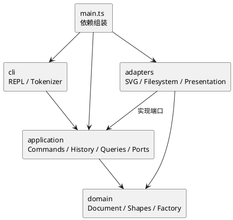

# SVG 编辑器 CLI：架构与开发记录

依据：[原始要求](../phase_cli_1.md)。任务拆解见 [开发计划](development-plan.md)，启动示例见 [工程 README](../README.md)。

交付仓库：<https://github.com/0039kk/SVG_PJ>。截止为北京时间 **2026-10-30 24:00，即 2026-10-31 00:00**。开发与阶段推送于 2026-10-29 完成；最终交付以远程 `final` 标签为准。

## 架构方案

### 模块划分与职责

```text
src/
  main.ts                        依赖组装和启动
  cli/                           Repl、Tokenizer
  application/
    commands/                    EditCommand 与 10 种具体编辑命令
    history/                     HistoryManager
    ports/                       FileGateway、SvgCodec、DocumentPresenter 接口
    queries/                     TreeQuery、ShowQuery
    services/                    EditorSession、CommandDispatcher
    InputToken.ts                不可变输入传输接口
  domain/
    document/                    SvgDocument、DocumentRoot、ChildList、Container
    shapes/                      Shape 抽象类及六种具体图形
    factories/                   ShapeFactory
    visitors/                    ShapeVisitor 接口
    errors/                      EditorError
    Values.ts                    数值、id、XML 文本值校验
  adapters/
    filesystem/                  NodeFileGateway
    svg/                         XmlSvgCodec、SvgOutputVisitor
    presentation/                TextDocumentPresenter、SummaryVisitor
tests/                           unit、integration、acceptance、fixtures
scripts/                         ArchitectureCheck、ReplayExamples
examples/                        命令脚本及生成的 SVG
doc/                             计划、架构与过程文档、渲染截图
```

SvgDocument 管理画布、id 索引与树操作。根画布独立于图形，不能通过 id 寻址。图形字段和子列表私有，读取属性和子节点返回副本。ChildList 维护父子双向关系，禁止重复挂载与环；assertInvariants 检查父引用、重复节点和唯一 id，并重建索引。



### 设计模式选择与落地

| 模式 | 实现 | 采用原因 |
|---|---|---|
| Command | EditCommand 及 Create/Delete/Move/Scale/Set/Group/Ungroup/AddTo/Front/BackCommand | 每条编辑一个对象，统一 execute/undo/redo；复杂分组也是一个历史单元 |
| Composite | Shape、GroupShape、Container；Group 对后代递归 move/scale，其他操作统一寻址 | 叶子和组通过同一命令操作，应用层不按图形类型分支 |
| Memento | EditCommand 私有 before/after 文档快照 | 恢复删除子树、跨父分组、属性原本不存在及 z-order |
| Factory | ShapeFactory 的类型名 → 构造器 Map；CLI 与 XML 读入共用 | 唯一图形类型分派点 |
| Visitor | ShapeVisitor、SummaryVisitor、SvgOutputVisitor | 图形 accept 调用具体访问方法；输出不依赖 tag switch |
| 端口与适配器 | FileGateway/SvgCodec/DocumentPresenter 由外层实现并注入 | 文件、XML、显示细节不污染命令与领域 |

**仅有的两处名字分派**：CommandDispatcher 的命令名映射与 ShapeFactory 的类型名映射；两处均标注为后续注册式扩展的**待重构点**。属性白名单属于各 Shape 内部行为，不用跨类型 switch 实现。编辑和显示没有 `shape.type === ...` 分派。

每个编辑先克隆文档，在工作副本上执行并校验，成功后才替换会话文档和登记历史。失败丢弃副本，redo 和屏障不变。undo/redo 恢复独立快照，不重复解析输入或进行 IO。一次编辑/快照约 O(N)，历史空间 O(H×N)，适用于课程规模；没有暗中裁剪历史。

read 先完整解析校验，最后替换文档并输出 warning；save 写同目录临时文件、同步并关闭，再 rename 替换目标，成功后才更新路径和屏障。失败清理临时文件；不承诺断电后目录元数据持久性或跨资源事务。

### 依赖方向规则

| 模块 | 允许依赖 | 原因 |
|---|---|---|
| domain | 本层及语言标准能力 | 业务规则独立于 Node/CLI/XML |
| application | domain、本层端口 | 命令、会话、历史可被其他交互通道调用 |
| adapters | domain、application 端口、所需外部库 | 提供端口实现，不决定历史策略 |
| cli | application、本层、Node 输入流/readline | 只分词、读入、输出，不直接修改图形或访问磁盘 |
| main | 全部模块 | 只做依赖组装 |

`check:architecture` 检查静态 import 方向、内核禁止外部库、类名/文件名一致、一类一文件、无自由函数声明与无 switch。它针对本仓库单行 import 风格，不是完整 AST 分析器；动态 import 会报错，名字分派和封装还需人工审查。

### 变化点假设

| 变化 | 预留 | 当前取舍 |
|---|---|---|
| 新交互通道 | EditorSession、命令与查询独立于 REPL | 不实现 GUI/HTTP/agent 协议 |
| 新图形或 box | 工厂、Shape 多态、容器及访问器边界 | 新类型仍需修改工厂与 Visitor；不提前实现插件系统，不承诺零内核改动 |
| 增量撤销 | execute/undo/redo 与 HistoryManager 分离 | 先以快照保证正确性 |
| 更换 XML/文件存储 | SvgCodec/FileGateway 接口 | 不引入数据库、云存储和多格式框架 |
| 显示格式变化 | DocumentPresenter、SummaryVisitor | 只提供终端文本 |

### 语义决策与支持范围

以下包含需求未完全定义时采用的实施基线：

- 成功 init/read/save/canvas 修改清空两栈并设置 IO 屏障；下一次成功编辑解除，只能撤销到屏障之后。查询、空行、注释、失败命令不影响历史。help 无文档可用。
- 无效果的有效编辑仍记一个单元，如 move 0 0。undo 后新成功编辑清 redo。
- group 按原树深度优先文档顺序收编，挂在旧父的最近公共祖先，位置为最早受影响的直接子分支处。同父时占最早选中位置。拒绝重复选择与祖先/后代组合。
- addto 追加到子列表末尾，禁止自身/祖先移入后代。跨父重组保留局部属性，不计算继承样式，不保证与未选节点的遮挡关系不变。
- move/scale 对组递归修改几何值，不写 transform；scale 以原点为中心，不改变 stroke-width。g 的公共样式设置自身属性，按 SVG 继承规则生效。
- front 为子列表末尾，back 为开头。根级 g 禁止 ungroup；嵌套 g 的子节点按原顺序替换其位置；空嵌套 g 可解散。
- 数值支持十进制、科学计数和浮点，全部有限；画布尺寸为正；坐标可负；图形尺寸、半径、stroke-width 非负。
- init 支持 0/1/2 参数，缺失维度使用 800/600；canvas 接受 0 或 2 参数。
- 首次 save 需要路径，成功显式 save 更新默认路径；read 更新路径，init 清除路径；空格路径用双引号。
- 首个非空白字符为 # 才是整行注释，颜色 #ffffff 不截断；无行尾注释。双引号支持空文本、转义双引号与反斜杠，其余反斜杠保留。quoted token 的 in 不作为尾缀关键字。
- read 先保留全文所有显式 id、拒绝重复，再按标签加最小可用正整数补 id；整份导入成功后才输出 warning。
- SVG 支持六种类型和白名单中的实际 SVG 属性；text 是子文本。缺失几何字段用 0；缺失样式不写出，遵循 SVG 默认值。
- 支持标准命名空间、XML 声明、注释、CDATA、中文、实体转义；简单无命名空间 svg 也接受。根尺寸支持数值或 px；viewBox 缺省或等于 `0 0 width height`。
- transform、非默认 viewBox、未知元素、影响呈现的其他属性、DTD、外部实体和样式处理指令显式拒绝，不静默丢失。XML 缩进、注释与属性顺序不保证保留。
- undo/redo 摘要为 `undone: <原操作摘要>` / `redone: <原操作摘要>`；表示撤销/重做该操作，tree/show 显示恢复后的具体值。

额外错误如 `nothing to undo`、`nothing to redo`、`no save path. use 'save <file.svg>'`、`invalid SVG XML` 在实现与测试中固定。需求明确规定的错误保持原文，外层添加 `error:` 并保证一行。

## 过程记录

以下为本次实际发生的协作与修正，没有虚构用户审阅或补造历史。

| 阶段 | 发现与判断 | 修正及证据 |
|---|---|---|
| 计划 | box 的未来示例容易误作本期功能；目录没有工程和 Git | 建 34 任务计划、固定六类型范围；提交基线 `8a32c37` |
| 领域 | 初稿把 Container 直接转为 Shape，类型检查指出根与叶子没有安全重叠 | 增加 Container.shape 能力，根为 undefined、组为自身；8 领域测试通过，提交 `002f424` |
| 命令/历史 | 逐命令逆操作易漏原父与顺序；递归 scale 可先改部分后溢出 | 工作副本加 before/after 快照；跨父恢复、后代溢出测试通过，提交 `b07e898` |
| 外部条件 | 用户补充仓库和 10 月 30 日晚 12 点截止，并强调分步 Git | 配置指定 origin，逐阶段 push，没有最后才建远程 |
| SVG | localName 类型可空；补 id 必须避让后部显式 id | localName 回退、全文预扫描 id；读写提交 `f843980` |
| 测试校正 | 测试把五元素误计为六；把 help 的 `<file.svg>` 中的 svg> 误判为提示符 | 核对树和 stdout，修正测试期望与行首匹配，没有修改正确产品行为 |
| 环境 | Windows 沙箱覆盖文件 rename 返回 EPERM | 获准在沙箱外复验，同一实现通过，保留原子保存 |
| 检查工具 | TypeScript 7 没有旧版 createSourceFile API | 使用针对源码风格的静态规则检查，明确能力边界并人工审查两处分派 |
| 验收 | 少量历史测试不足以代表全部编辑；命名空间重置可能改变 SVG 语义 | 补 17 组 undo/redo，拒绝子元素清空命名空间；最终 60 测试通过，验收提交 `ee07fe1` |
| 渲染 | XML 可解析不等于视觉正确 | Edge 实际渲染并查看流程图截图，矩形、中文和连接线正常 |

测试随功能加入，提交随真实阶段推进。初期命令阶段没有最终启动器，从 SVG 阶段开始可完整运行。可用 `git log --oneline` 与 diff 审查。

## 一致性自查

### 模块划分

实际四层、main 入口及 tests/examples/doc 符合方案。修订如下：

1. 新增 ChildList 共享父子规则；Container 为能力接口，DocumentRoot 独立于 Shape。
2. 快照封装在 EditCommand，没有单独 HistoryEntry，避免纯字段包装层。
3. 文档服务合入 EditorSession；help 从命令 Map 生成，没有额外 HelpQuery 类。
4. 展示端口位于 application/ports，适配器注入查询，CLI 不直接依赖适配器。
5. 新增 scripts 检查/回放；接口和不可变传输对象不是公共可变领域数据袋。

### 依赖方向

- 静态检查通过：43 个源码文件，类名/文件名一致，一类一文件，无 switch。
- 抽查 Shape 只依赖 domain；EditorSession 依赖 domain 和端口；Repl 依赖 application、本层和 Node 输入流；XmlSvgCodec 在 adapter 内使用 xmldom。
- create/read 共用工厂；move/scale/set/delete 不按 tag 分流；显示与 XML 输出使用 Visitor。
- 未发现违反依赖规则的待处理项；注册扩展和大图历史性能是明确的未来取舍。

## 质量保证手段

### 实际验证结果

环境：Windows、Node.js 24.14.1、npm 11.11.0。依赖由 package-lock.json 固定，Node engines 对齐已安装工具支持范围。

| 检查 | 结果 |
|---|---|
| typecheck / build | strict 类型检查及编译通过 |
| check:architecture | 43 源码文件通过 |
| npm test | 4 文件、60 项全部通过 |
| npm run examples | 编译后两份脚本通过：流程图 8 元素，典型会话保存 5 元素并读入 7 元素，仅出现规定的 2 个错误 |
| 浏览器 | Edge 实际打开 flowchart.svg，截图检查通过 |

测试分布：domain 8 项；commands 24 项（含 17 组编辑撤销重做）；svg 25 项；真实 CLI 子进程 3 项。失败测试比较内容、父子顺序、路径、栈计数和屏障；递归溢出确认没有局部生效。往返按领域语义比较，不要求 XML 排版一致。

### 人工证据


截图来自 examples/flowchart.svg：node2 移动已撤销，两节点同一水平位置；文字为“处理数据 v2”。连接线按需求使用 line，没有额外 marker。

### 交付复验与 Git

- 工程、领域、命令/历史、SVG IO、验收已分步提交并逐阶段推送。
- 冻结前在 `.verification/clean-checkout` 干净检出，以 npm ci、npm run check、npm run examples 复验；实际结果将在最终冻结记录确认。
- 复验后创建并推送附注标签 final，核对远程 tag 与 main 对应同一最终提交，不移动已有 final。

### 已知限制

不支持完整 SVG 标准、transform、非默认 viewBox、任意 CSS/字体、其他元素及动态插件，导入时明确拒绝。历史为完整快照，没有大图性能优化。进程崩溃、断电及 stdout 失败不属于跨资源事务保证；正常验证、解析和文件写入失败均保持会话状态。
