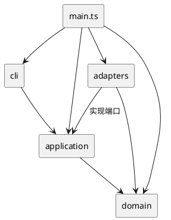

# SVG 编辑器 CLI 开发文档

| 项目 | 内容 |
|---|---|
| 版本 | 0.1.0 / Phase 1 |
| 更新日期 | 2026-10-30 |
| 开发语言 | TypeScript |
| 运行环境 | Node.js |
| 需求文档 | [phase_cli_1.md](../phase_cli_1.md) |
| 相关文档 | [运行说明](../README.md)、[开发计划与进度](development-plan.md) |

## 架构方案

### 1. 模块划分

项目分为领域层、应用层、交互层和适配器层。领域层负责图形行为与树结构约束；应用层组织命令执行和编辑历史；交互层处理终端输入输出；适配器层实现 SVG、文件系统及显示格式。

```text
src/
  main.ts                     依赖组装与程序入口
  domain/
    shapes/                   Shape 及六种具体图形
    document/                 SvgDocument、DocumentRoot、Container、ChildList
    factories/                ShapeFactory
    visitors/                 ShapeVisitor
    errors/                   EditorError
    Values.ts                 数值、id 和文本校验
  application/
    commands/                 EditCommand 及具体编辑命令
    feedback/                 MoveFeedbackVisitor
    history/                  HistoryManager
    ports/                    FileGateway、SvgCodec、DocumentPresenter
    queries/                  TreeQuery、ShowQuery
    services/                 EditorSession、CommandDispatcher
    InputToken.ts             命令输入类型
  cli/                        Tokenizer、Repl
  adapters/
    filesystem/               NodeFileGateway
    svg/                      XmlSvgCodec、SvgOutputVisitor
    presentation/             TextDocumentPresenter、SummaryVisitor
tests/                        单元、集成与 CLI 验收测试
scripts/                      架构检查和示例回放
examples/                     命令脚本与 SVG 示例
```

`SvgDocument` 保存画布尺寸、根节点和 id 索引，对外提供创建、删除、分组、移动归属及排序等操作。`Shape` 封装几何与样式属性，具体图形通过多态实现移动、缩放、属性设置、克隆和访问器调用。`ChildList` 统一维护父子引用，检查重复挂载和环。

根画布使用独立的 `DocumentRoot`，不作为可寻址的 g 元素。图形属性和子节点列表返回副本，避免外部代码直接修改内部集合。树更新后调用 `assertInvariants()` 校验父引用、节点唯一性和 id 索引。



### 2. 设计模式

| 模式 | 对应实现 | 作用 |
|---|---|---|
| Command | EditCommand、10 种编辑命令、HistoryManager | 将一次编辑封装为一个历史单元，统一 execute、undo、redo |
| Composite | Shape、GroupShape、Container | 统一叶子与容器操作，支持递归组合 |
| Memento | EditCommand 的 before/after 快照 | 恢复几何、样式、父子结构和节点顺序 |
| Factory | ShapeFactory | 集中创建六种图形，供 CLI 与 SVG 读取共用 |
| Visitor | ShapeVisitor 及显示、SVG 输出、移动反馈访问器 | 通过多态处理图形，避免多处按标签分支 |

文件和格式处理采用端口与适配器结构。应用层声明 `FileGateway`、`SvgCodec` 和 `DocumentPresenter`，由外层提供具体实现，并在入口处注入。

名字分派集中在两处：`CommandDispatcher` 负责命令名映射，`ShapeFactory` 负责类型名映射。这两处是后续插件化的待重构点。移动、缩放、删除和显示不再按图形类型名分派；属性白名单由各图形内部校验。

### 3. 依赖方向

| 模块 | 允许依赖 | 约束 |
|---|---|---|
| domain | 本层及语言标准能力 | 不依赖 Node IO、终端或 XML 库 |
| application | domain、本层接口 | 不依赖适配器和 REPL |
| cli | application、本层、Node 输入流与 readline | 不直接修改图形或读写文件 |
| adapters | domain、application 端口、相关外部库 | 实现技术细节，不管理编辑历史 |
| main.ts | 所有模块 | 仅组装依赖并启动 |

`ArchitectureCheck` 检查静态 import 方向、内核外部依赖、类名与文件名、一类一文件及 switch 使用情况。检查器针对当前单行 import 形式工作，动态导入需单独审查。类型名分派和字段封装由代码审查补充检查。

### 4. 关键实现

#### 4.1 编辑事务与历史

每条编辑命令按以下顺序执行：

1. 克隆当前文档，得到工作副本。
2. 在副本上修改，检查几何、属性和树结构约束。
3. 生成成功反馈，并根据原文档生成撤销反馈。
4. 保存前后快照，替换会话文档，登记历史。

任一步骤失败，当前文档、保存路径、redo 栈和历史屏障保持不变。undo/redo 直接恢复独立快照，不重新执行原命令或文件 IO。

成功的 init、read、save、canvas 尺寸修改清空历史并设置 IO 屏障，下一次成功编辑解除屏障。查询、空行、注释及失败命令不影响历史；undo 后的新成功编辑清空 redo。无效果但有效的编辑仍记录一个历史单元。

完整快照简化了跨父分组、删除子树和属性恢复的实现。一次编辑时间约 O(N)，H 条历史的存储约 O(H×N)。当前版本面向小规模文档，后续可根据实际负载改为增量操作或持久化树。

#### 4.2 树操作与几何变换

所有图形 id 全局唯一且大小写敏感，不能通过 set 修改。每个图形只有一个父容器，禁止重复引用和祖先环。

`group` 按原树文档顺序收编图形，新组挂在原父容器的最近公共祖先中，插入到最早受影响的直接子分支位置。`addto` 将图形追加到目标容器末尾。跨父操作保留节点局部属性，继承样式和遮挡关系可能随归属改变。

嵌套组解散时，其子节点按原顺序替换组的位置。根级组禁止 ungroup。SVG 按子节点顺序绘制，因此 front 移到列表末尾，back 移到开头。

坐标允许负数和浮点，画布尺寸为正，尺寸、半径及 stroke-width 非负，所有数值必须有限。move/scale 对组递归修改后代几何值；scale 以原点为中心，不改变 stroke-width。组的样式设置写入自身属性，遵循 SVG 继承规则。

#### 4.3 SVG 读写

`XmlSvgCodec` 使用 XML 库解析文档。读入时先扫描全部显式 id，再为缺失 id 分配标签名加最小可用序号，避免与后续元素冲突。整份文档校验通过后才替换当前文档并输出 warning。

| 支持内容 | 处理方式 |
|---|---|
| rect、circle、ellipse、line、text、g | 还原为对应领域对象 |
| 公共样式与各类型几何属性 | 按白名单校验，缺失样式不补写 |
| 文本、中文、CDATA 和实体转义 | 通过文本节点读写；CR 保留为字符引用 |
| XML 声明、注释、标准 SVG 命名空间 | 允许读入；注释和原始排版不保证保留 |
| 根尺寸与 viewBox | 尺寸支持数值或 px；viewBox 缺省或等于 0 0 width height |
| transform、其他 viewBox、未知元素、额外呈现属性 | 明确报错 |
| DTD、外部实体、样式处理指令 | 拒绝读入 |

简单无命名空间的 SVG 也可读入；命名空间被重置或指向其他格式时拒绝。缺失几何字段使用 0。SVG 往返保证支持范围内的语义，不要求属性顺序、缩进和自闭合形式逐字一致。

保存通过同目录临时文件完成，写入、同步和关闭后再替换目标；成功后更新默认路径及历史屏障。失败时清理临时文件。首次 save 需指定路径；read 和显式 save 更新默认路径，init 清除路径。

#### 4.4 命令反馈

反馈依据执行后或恢复后的状态生成。需求示例中的叶子移动显示目标坐标，容器移动显示增量；撤销文本显示原内容，撤销删除显示原父容器。redo 使用对应成功结果，不添加额外前缀。

```text
circle#c1 moved to (130,100)
circle#c1 moved back to (100,100)
circle#c1 moved to (130,100)
text#title updated: text="My Diagram"
rect#box restored into g#markers
g#node2 moved back by (0,-100)
```

未规定固定措辞的编辑撤销同样报告恢复结果，例如属性移除、缩放恢复或原排序位置。错误统一使用 `error:` 前缀，每行一条；需求明确给出的错误文本保持一致。

### 5. 变化点与扩展

| 变化点 | 当前边界 | 后续处理 |
|---|---|---|
| 新交互通道 | 命令和会话独立于 REPL | 可在应用层上接入其他入口 |
| 新图形或 box | Shape、工厂、容器和 Visitor | 当前仍需修改工厂和访问器，插件阶段改造注册机制 |
| 历史性能 | Command 与 HistoryManager 分离 | 可替换快照策略，不改 CLI 语法 |
| XML 库与文件存储 | SvgCodec、FileGateway 端口 | 更换适配器，保留应用接口 |
| 显示格式 | DocumentPresenter 与反馈访问器 | 格式变化集中在展示或反馈实现 |

本阶段未实现动态插件、GUI、CSS 计算及完整 SVG 兼容。扩展这些能力需要重新确定读写和测试范围。

## 过程记录

开发中使用 Codex 辅助方案讨论、代码实现和测试编写。迭代重点包括领域模型约束、复杂命令恢复、SVG 往返和需求反馈一致性。

### 1. 领域结构调整

初始实现将 Container 直接转换为 Shape，类型检查暴露了根画布和普通图形的差异。调整为 Container 提供只读 shape 能力：根返回 undefined，Group 返回自身。父子关系改由 ChildList 维护，避免各命令重复处理引用更新。

### 2. 撤销方案选择

方案讨论中比较了逐命令逆操作与完整快照。逆操作需要分别记录原父节点、插入位置、属性是否存在等信息，跨父分组和删除子树的恢复较复杂。当前采用副本执行和前后快照，并通过跨父恢复、属性移除及后代数值溢出测试检查正确性。

### 3. SVG 往返修正

自动补 id 采用全文显式 id 预扫描，避免与文件后部元素冲突。文本往返测试发现 CR 被 XML 行尾规则归一化为 LF，因此输出时使用字符引用保留。解析过程对命名空间重置、未知属性和不支持的变换明确报错，避免读入后改变原图语义。

### 4. 反馈与验收调整

早期反馈统一使用 moved by 和 undone/redone，虽然能够说明操作，仍与需求会话存在差异。修订后增加 MoveFeedbackVisitor 和命令撤销摘要，从需求 Markdown 中直接提取第 6 节及 6.1 版本 A 的会话，逐条比较命令反馈，同时检查真实 CLI 子进程输出。

验证过程中也修正了测试本身的问题：元素数量误计、提示符子串误判，以及验证目录导致的重复测试发现。测试范围现限定为 tests/，当前共 79 项。

### 5. 版本记录

工程、领域模型、命令历史、SVG IO、集成测试和修正分别形成提交。相关记录包括 `002f424`（领域模型）、`b07e898`（命令与历史）、`f843980`（SVG IO）、`ee07fe1`（集成验收）和 `a5f3334`（文本及测试发现修正）。

反馈修订提交为 `49a168b`，开发文档随发布版本更新。最终交付版本通过仓库的 `final` 标签定位。

## 一致性自查

### 1. 模块与方案

实际代码保留 domain、application、cli、adapters 四层及 main 入口。与初始方案相比，调整如下：

- 增加 ChildList，共享父子引用和防环规则；DocumentRoot 独立于 Shape。
- 前后快照直接放在 EditCommand 中，未单独建立 HistoryEntry。
- 文档服务合入 EditorSession；help 从命令定义生成，未单独建立 HelpQuery。
- DocumentPresenter 定义在应用端口中，由适配器注入查询。
- 新增 application/feedback，使用现有 Visitor 生成移动反馈。

目录与类名一致，接口和不可变输入类型单独存放，领域对象通过方法维护自身状态。

### 2. 依赖检查

最近一次静态检查覆盖 44 个源码文件，依赖方向、类名与文件名、一类一文件及 switch 检查通过。抽查结果如下：

| 检查对象 | 实际依赖 |
|---|---|
| Shape | domain 内部类型与校验 |
| EditorSession | domain、应用命令、历史和端口 |
| Repl | application、本层、Node 输入流 |
| XmlSvgCodec | domain、应用端口、XML 库 |
| MoveFeedbackVisitor | domain 的图形与访问器接口 |

create/read 共用 ShapeFactory；编辑与显示未新增类型名分派。当前未发现违反依赖规则的项。命令映射、图形工厂的注册式扩展仍为后续重构任务。

## 质量保证手段

### 1. 自动化验证

最近一次完整验证日期为 2026-10-30，环境为 Windows、Node.js 24.14.1、npm 11.11.0。依赖版本由 package-lock.json 固定。

| 检查 | 结果 |
|---|---|
| npm run typecheck | strict 类型检查通过 |
| npm run build | 编译通过，可运行 dist/main.js |
| npm run check:architecture | 44 个源码文件通过 |
| npm test | 5 个测试文件、79 项通过 |
| npm run examples | 两份编译后 CLI 会话回放通过 |

| 测试文件 | 数量 | 验证内容 |
|---|---:|---|
| unit/domain.test.ts | 8 | 叶子几何、递归组、克隆独立和树约束 |
| integration/commands.test.ts | 24 | 分词、历史屏障、失败原子性、各编辑撤销重做 |
| integration/svg.test.ts | 25 | 语义往返、id 避碰、XML 异常、文件覆盖和失败清理 |
| acceptance/cli.test.ts | 3 | 实际 CLI 进程、两份需求会话、EOF |
| integration/feedback.test.ts | 19 | 需求反馈逐字比对、恢复结果和重复 undo/redo |

失败用例比较文档内容、父子关系、节点顺序、路径、历史计数及屏障。递归缩放溢出测试检查是否出现部分修改；快照测试检查对象是否共享引用。XML 测试比较支持范围内的领域语义。

两份示例回放分别生成 8 元素流程图和 5 元素示意图，典型会话随后读入 7 元素外部 SVG。会话中仅出现需求指定的两条错误。

### 2. 图形显示检查

生成的 flowchart.svg 已使用 Edge 渲染并检查：两个节点保持相同高度，中文和连接线显示正常，文字更新为“处理数据 v2”。


### 3. 交付复验

基线提交 a5f3334 已在干净检出目录执行依赖安装、完整检查和示例回放，结果通过。2026-10-30 对反馈修订版重新执行完整检查，79 项测试及两份编译后 CLI 会话回放通过。

发布验收以最终提交的干净检出为准，依次执行 `npm ci`、`npm run check` 和 `npm run examples`，并确认回放后没有产生已跟踪文件差异。验收通过后创建附注标签 final，使用原子推送同时发布 main 和 final，核对远程分支与标签解析后指向同一提交。已存在的 final 不自动覆盖，远程分支出现分歧时不执行强制推送。
