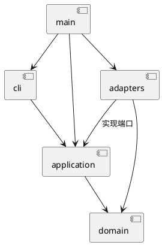

# SVG 编辑器 CLI

## 架构方案

采用 TypeScript 面向对象实现。领域层维护图形、树和 id 不变量；应用层实现 Command、文档操作和历史；CLI 仅负责输入；适配器实现 XML、文件系统和输出。依赖从外层指向内层，domain 不依赖 Node/CLI/XML，application 不依赖适配器，cli 不直接操作领域或文件。

设计模式：Command 管理每条编辑；Composite 统一叶子和 g；Memento 保存前后文档快照；Factory 集中图形构造；Visitor 隔离展示与 SVG 输出。命令分发和图形工厂是仅有的两处名字分派，标注为后续注册式扩展的待重构点。本阶段不实现 box/插件。

变化点：额外交互通道通过应用层复用；新增图形需要调整工厂与 Visitor（目前不承诺插件零改动）；文件系统和 XML 库通过端口替换；历史可由快照改为增量，但本阶段优先保证恢复正确。

### 语义基线

- 成功 init/read/save/canvas 修改清空历史并设置屏障；下一次成功编辑解除屏障。查询、注释及失败命令不影响历史。
- group 保持原树文档顺序，在旧父的最近公共祖先中创建，位置为最早受影响的直接子分支处。跨父重组不计算继承样式，不保证遮挡外观不变。
- move/scale 对组递归修改几何值，不写 transform；scale 不改变 stroke-width。g 的样式设置遵循 SVG 继承。
- front 是 SVG 子列表末尾，back 是开头。根级 g 禁止 ungroup。
- 画布正尺寸；坐标允许负数；半径、图形尺寸、stroke-width 非负；所有数值有限。
- 首次 save 需要路径，成功显式 save 更新默认路径；init 清除默认路径。
- 仅支持六类型、白名单属性和默认 viewBox；transform、非默认 viewBox 等不支持的呈现语义显式报错，不静默丢失。
- 先收集全部显式 id 再补缺失 id；拒绝重复 id。help 无文档也可用。

上述未完全由需求定义的行为是本项目的实施决策。详细任务与依据见 [开发计划](development-plan.md)。

## 过程记录

- 2026-10-29：读取需求并制定 7 阶段、34 任务计划；用户授权开始开发。发现目录无工程和 Git，先建立工程与架构基线。尚无远程仓库地址和截止时间，已请求补充。

## 一致性自查

实施中，待功能完成后按实际目录与 import 检查结果填写，不预先宣称通过。

## 质量保证手段

计划以领域单测、命令/历史集成、SVG 往返、文件失败和真实 CLI 回放验证，并运行类型检查、构建与依赖检查。实际测试结果将在完成后记录。
