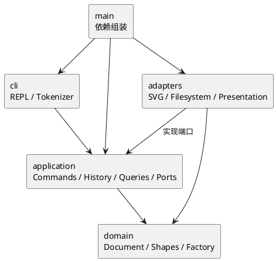

# SVG 编辑器 CLI：Phase 1 开发计划

> 依据：`phase_cli_1.md`。本文是待实施的开发方案，不代表功能已经完成。
> 计划基线：2026-10-29；当前目录仅有需求文档，没有源码、工程配置或 Git 仓库。
> 本轮范围：需求分析、任务拆解与开发计划。初始化工程、安装依赖、编写功能、推送远程和打标签属于后续实施任务。
>
> 实施更新（2026-10-29）：用户已授权功能开发，M0–M5 已完成，60 项测试通过；M6 正在干净检出复验。远程为 https://github.com/0039kk/SVG_PJ.git，截止为北京时间 2026-10-30 24:00。以下保留制定时的计划基线，实际架构修订与验收见 [doc/README.md](README.md)。

## 1. 目标、范围与完成标准

### 1.1 本阶段目标

用 TypeScript 面向对象实现可交互、可脚本回放的 SVG 命令行编辑器。架构必须体现 Command、Composite，支持六种内置图形、完整命令集、编辑历史和 SVG 文件读写。

必须同时交付以下三类成果：

1. **功能**：需求中的 Phase 1 命令、错误约定、显示格式和示例会话可验证。
2. **架构**：类层次、多态、字段封装、一类一文件；依赖方向清晰；没有散落的按图形标签分支。
3. **过程**：真实、分阶段的 Git 历史，远程仓库，`doc/README.md`，截止时间前创建并推送的 `final` 标签。

### 1.2 范围边界

| 本阶段必须实现 | 本阶段不安排实现 |
|---|---|
| `rect / circle / ellipse / line / text / g` | `box` 复合图形及其插件 |
| 文档、编辑、显示、undo/redo 全部命令 | 动态插件加载、完整 ShapeProvider 插件系统 |
| `create ... in ...`、分组、嵌套、排序 | GUI、鼠标操作、agent 接口、路径寻址 |
| 六种类型组成的 SVG 读写及缺失 id 补全 | 任意 SVG 标准元素、CSS、滤镜、动画等完整兼容 |
| 浏览器打开保存结果进行人工验证 | 内置渲染器、实时画布预览 |

`create box` 必须按未知类型报错。需求中关于 box 的展示属于未来目标，不作为本阶段开发任务；为未来扩展保留边界即可，不提前搭建插件平台。

### 1.3 最终完成标准

- 所有本阶段命令都有正常路径、失败路径和适用的历史行为验证。
- 一条成功的编辑命令对应一个 undo 单元；失败不改变文档、路径、历史栈或历史屏障。
- SVG 保存后可在浏览器显示；读回后支持范围内的语义、层级、顺序及属性保持一致。
- 文档描述与实际目录、依赖和代码一致，过程记录有真实证据。
- 从干净检出可按 README 启动和测试；远程存在对应最终提交的 `final` 标签。

## 2. 需求清单与验收映射

| 编号 | 需求组 | 具体覆盖 | 主要任务 | 主要验收 |
|---|---|---|---|---|
| R01 | CLI 约定 | `svg>`、启动信息、逐行读取、注释、双引号、中文、浮点参数 | T11–T13 | CLI 输入与 transcript 测试 |
| R02 | 文档操作 | `init/read/save/canvas`、默认尺寸、当前路径 | T14、T26–T28 | 文档命令及文件失败测试 |
| R03 | 基础图形 | 六种类型、唯一且大小写敏感的 id、公共及类型属性 | T05–T08、T17 | 模型测试、各类型创建测试 |
| R04 | 统一编辑 | `delete/move/scale/set` 对叶子与容器统一操作 | T18 | 嵌套递归与属性白名单测试 |
| R05 | 树操作 | `in/group/ungroup/addto/front/back` | T09、T19–T21 | 树不变量及顺序恢复测试 |
| R06 | 显示 | `tree [id]/show/help`、几何属性内联、父节点 | T15–T16 | 文本输出比对 |
| R07 | 编辑历史 | Command、undo/redo、新编辑清 redo、文档操作屏障 | T22–T24 | 历史状态转换测试 |
| R08 | SVG IO | XML、文本转义、缺 id 警告、重复 id、失败原子性 | T25–T29 | round-trip 与异常文件测试 |
| R09 | 错误约定 | `error:`、一行一条、规定错误文本、失败无副作用 | T10、T13、T24、T29 | 错误矩阵与前后状态比较 |
| R10 | 面向对象架构 | Command、Composite、封装、一类一文件、仅两处名字分派 | T03–T10、T31 | 架构审查与依赖检查 |
| R11 | 提交与文档 | 分步提交、远程、`doc/README.md`、`final` | T01–T04、T32–T34 | 干净检出、文档及标签核对 |

## 3. 实施前的语义决策

以下区分“需求明确规定”和“文档未完全定义”。未定义项先采用建议基线，并在编码前写入 `doc/README.md` 的决策记录；若后续获得课程补充说明，应更新方案和相应测试。

| 议题 | 明确规定或问题 | 建议实施基线 |
|---|---|---|
| 文档命令后的历史 | 成功的 init/read/save、canvas 修改后禁止 undo/redo，直到下一次编辑 | 成功时清空两栈并进入屏障；下一次成功编辑只记录屏障后的版本。屏障前历史不恢复。此处“清栈”是方案选择 |
| 不改变文档的命令 | tree/show/help 不入栈；canvas 无参数为查询 | 全部查询保持历史与屏障；help 在无文档时也可用。空行、注释同样无影响 |
| 文档命令失败 | 命令失败不改变任何状态 | read/save/canvas 失败均不清栈、不改路径、不改变屏障；read 的警告在整份文件验证通过后输出 |
| 无默认保存路径 | `save` 无参数保存到读入路径；init 后无路径没有说明 | init 后首次 save 必须给路径；成功的显式 save 更新当前保存路径；错误文本在 M0 固定 |
| canvas 参数 | 显示或修改尺寸；缺省参数组合未完全规定 | `canvas` 查询，`canvas w h` 修改，单参数报参数错误；init 支持 0/1/2 参数，缺失维度用默认值 |
| 数字有效域 | 浮点合法，scale 必须为正 | 所有数值必须有限；坐标允许负数；尺寸、半径、stroke-width 非负，画布尺寸为正；拒绝 NaN/Infinity 与尾随非法字符 |
| scale 语义 | 位置与尺寸同乘 factor；容器递归 | 以画布原点缩放几何坐标与尺寸；每个后代仅处理一次，不缩放 stroke-width 或未要求支持的字体属性 |
| g 的 move/scale/set | 必须有 Composite 语义；set 有白名单 | move/scale 递归修改后代几何值；g 的 set 只设自身 fill/stroke/stroke-width，按 SVG 继承规则生效，不覆盖后代显式样式；g 不接受 x 等属性 |
| 分组目标位置 | 允许从各自父容器摘出，但新组挂载位置、跨父相对顺序未定义 | 新组放到所选节点原父容器的最近公共祖先中，插到最早受影响的直接子分支之前；同父选择时占最早所选位置；子节点按原树深度优先文档顺序排列 |
| 跨父重组外观 | 只规定结构与相对顺序，未规定样式固化 | 保留节点局部属性；重新归属可能改变继承样式或与未选节点的遮挡关系，不承诺跨父重组后像素完全一致；不额外实现样式计算 |
| 防环与重复参数 | group 不得同时含祖先与后代 | group 重复选择报错；addto 拒绝自身及祖先移入后代。所有检查在修改前完成 |
| ungroup | 根级 g 禁止解散；子节点占据原组位置 | 严格实现该限制；嵌套 g 解散后按原子节点顺序插入父级；空嵌套 g 可解散。叶子参数报非容器错误；box 专属错误不虚构实现 |
| front/back | 同级最前/最后 | front 移到 children 数组末尾，对应 SVG 最后绘制；back 移到开头；中文显示顺序与绘制顺序在文档中说明 |
| 无效果编辑 | move 0 0、移到已有排序位置等未定义 | 有效且成功的编辑仍算一个历史单元，并解除历史屏障，以维持“一条编辑命令一个单元” |
| 引号与注释 | `#` 开头的行为注释；颜色本身包含 # | 仅整行首个非空白字符为 # 时跳过，不实现行尾注释；双引号保留空格和空字符串；建议支持 `\"` 与 `\\`，未闭合引号报错 |
| in 尾缀与文本冲突 | in 是 create 的可选尾缀；文本可能恰好为 in | token 保留是否被引号包裹的信息；先识别完整类型参数，再识别未加引号的末尾 in 子句；`"in"` 不作为关键字 |
| 补 id 冲突 | 缺 id 按标签加序号分配 | 先扫描并保留全部显式 id，拒绝重复，再为缺失 id 分配最小可用正序号；避免与文件后部显式 id 冲突 |
| 支持的外部 SVG | 正文示例出现 transform，但命令与读写支持范围未明示 | 优先保证六种元素、白名单属性、基本 width/height/viewBox 的读写。transform、非默认 viewBox、未知图形及影响呈现的未支持属性先显式拒绝，不静默丢失；在 M0 确认课程是否要求扩展 |
| XML 外壳 | SVG 常含声明、注释和命名空间 | 接受 XML 声明、注释和标准 SVG 命名空间；只忽略结构性空白；text 内容保留；禁用 DTD/外部实体；不承诺保留注释和 XML 排版 |
| 成功输出细节 | 有摘要示例，但未规定全部命令模板 | 错误字符串按规范精确实现；成功摘要及 tree/show 用固定模板，宽度对齐只作格式化，不参与领域逻辑 |

**M0 需优先核对的三个问题**：外部 SVG 的 transform/viewBox 支持范围、跨父 group 的挂载规则、文档命令是否彻底丢弃旧历史。未获得补充说明时按上表基线实施，并明确记录依据，不能把建议描述成原文要求。

## 4. 架构设计

### 4.1 模块与职责

```text
src/
  main.ts                         # 组装依赖和启动，无业务规则
  cli/                            # Repl、Tokenizer、输入输出和错误呈现
  application/
    commands/                     # 每个编辑命令一个类
    queries/                      # TreeQuery、ShowQuery、HelpQuery
    history/                      # HistoryManager、HistoryEntry
    ports/                        # FileGateway、SvgCodec 接口
    services/                     # 编辑执行器、文档服务、命令分发
  domain/
    shapes/                       # Shape、六种具体图形，一类一文件
    document/                     # SvgDocument、根画布、id 索引与树操作
    factories/                    # 内置图形工厂，唯一类型名分派点
    visitors/                     # 面向图形多态访问的接口
    errors/                       # 领域错误；不打印、不读文件
  adapters/
    filesystem/                   # NodeFileGateway
    svg/                          # XmlSvgCodec、SVG 读写访问器
    presentation/                 # tree/show/命令摘要格式化
tests/
  unit/
  integration/
  acceptance/
  fixtures/
examples/                         # 可回放命令脚本、SVG 样例
doc/
  development-plan.md             # 本计划
  README.md                       # 最终要求的架构、过程、自查与质量说明
```

目录为方案，不要求每个目录都强行创建大量类；按职责需要落文件。接口及明确标注的不可变传输对象可以独立文件，不能用公共数据袋取代领域对象。

### 4.2 依赖方向

| 模块 | 允许依赖 | 禁止与原因 |
|---|---|---|
| domain | 同层领域类、语言标准能力 | 不依赖 CLI、Node IO、XML 库、application；保持业务规则可单测 |
| application | domain、本层端口 | 不依赖适配器实现与 REPL；让命令执行可复用 |
| adapters | application 端口、domain、对应外部库 | 不依赖 CLI，不承载 undo/redo 策略 |
| cli | application、其公开输入输出类型 | 不直接修改图形，不直接调用文件系统或 XML 库 |
| main.ts | 上述模块 | 只做依赖组装，不成为业务入口上帝类 |

用静态依赖检查或等价脚本禁止反向 import，并人工抽查是否通过传入的具体对象绕过边界。



### 4.3 设计模式及落地

| 模式 | 具体落地 | 验证方式 |
|---|---|---|
| Command（必选） | Create/Delete/Move/Scale/Set/Group/Ungroup/AddTo/Front/Back 各为命令类；统一 execute/undo/redo 协议，由执行器和历史管理器管理 | 命令通过同一入口执行；任一编辑均可按一个单元撤销重做 |
| Composite（必选语义） | Shape 为抽象类；GroupShape 持有私有有序 children；叶子和组统一实现 move/scale/set、遍历与克隆 | 同一命令处理叶子、空组、多层组；application 不按 tag 分流 |
| Memento（实现策略） | 每次编辑保留 before/after 文档快照，undo/redo 恢复快照 | 删除子树、跨父重组、排序和属性不存在状态均可精确恢复 |
| Factory | 工厂将类型名映射为具体 Shape；CLI create 与 XML read 共用类型构造入口 | 第三处标签 switch 不出现；未知类型由同一策略处理 |
| Visitor（有明确用途） | 图形通过 accept 进入 tree/show/SVG 输出访问器；各访问器用类型化方法处理图形 | 输出层不复制 tag 分支；领域层不导入 XML/终端库 |
| 端口与适配器 | 文件系统与 XML 编解码通过接口注入 | 用内存文件网关验证读写失败；业务测试无需真实磁盘 |

**仅允许的两个名字分派点**：命令名 → 命令构造器/处理器；图形类型名 → Shape 构造器。集中放置，架构文档标注为后续注册式扩展的待重构点。本阶段不再在 XML、显示、移动、缩放等位置增加按 tag 分派。

属性白名单属于各 Shape 的属性校验职责，不能演变成跨类型的统一大 switch。公共样式由基类处理，类型几何属性由子类封装。

### 4.4 状态模型与失败原子性

运行状态至少包含：当前文档、当前保存路径、undo 栈、redo 栈、IO 屏障标志。文档自身包含尺寸、有序树和 id 索引。

编辑执行流程：

1. 分词、参数检查、命令构造，不改运行状态。
2. 克隆当前文档为工作副本，在副本上执行；域对象校验唯一 id、合法属性和树约束。
3. 执行失败则丢弃副本；成功输出也先完成构造，避免输出格式错误发生在提交之后。
4. 成功后原子替换当前文档，登记 before/after 历史条目，清 redo，解除屏障。
5. undo/redo 恢复独立快照及索引，不重新解析用户输入、不重新运行文件 IO。

read 在临时文档中完成整份解析和验证后才替换当前文档；save 只有在文件写入成功后才更新路径和历史屏障。控制台输出失败与外部磁盘故障不可能和内存实现统一事务，但不得因已知失败提前推进会话状态。

文件保存建议采用同目录临时文件与替换，避免截断已有文件；验证目标平台行为，并记录文件系统无法保证的故障边界。失败不得遗留成功状态或影响下一条命令。

**快照取舍**：每次编辑约 O(N) 时间及 O(N) 新增历史空间，历史总空间约 O(H×N)。对课程规模优先保证正确性；不宣称适合超大 SVG。本阶段不做增量逆操作优化；若性能验收确有需要，再根据测量调整。

### 4.5 领域不变量

- 根画布作为独立 DocumentRoot，不冒充可寻址 g；`tree` 的根显示 svg，不要求为根自动补 id。
- 每个受支持图形必须有全局唯一、大小写敏感的 id；id 不在 set 白名单内，不能被修改。
- 除根外每个节点恰有一个父容器；禁止环、重复引用或同一节点出现在两处。
- 索引与树完全一致；删除或恢复子树必须同步所有后代。
- children 顺序就是 SVG 文档顺序；读取、保存、分组、撤销均保持可解释的顺序。
- shape 字段和 children 不对外暴露可写引用；快照之间不共享可变对象。

### 4.6 变化点预留

| 可能变化 | 当前预留 | 本阶段不做的工作 |
|---|---|---|
| CLI 之外增加交互通道 | application 不依赖 readline/stdout，命令输入输出有边界 | 不开发 HTTP、GUI 或 agent 协议 |
| 增加图形或 box 插件 | 工厂、Shape 多态、容器能力、IO/显示访问边界 | 不实现动态注册、插件生命周期；未来新增类型仍可能修改工厂和 Visitor，明确记录此限制 |
| undo 从快照改增量 | Command 与 HistoryManager 隔离 | 不提前编写复杂逆操作框架 |
| 读写其他格式或储存位置 | SvgCodec、FileGateway 端口 | 不引入数据库、云存储 |
| 输出格式变化 | 展示格式集中在 presentation | 不做多语言系统或主题系统 |

## 5. 分阶段任务拆解（WBS）

每项任务完成后至少更新相关测试或验收证据，适合形成独立提交时再提交。下表是计划单元，不要求机械地“一行一个 commit”。

### M0：需求定稿与工程基线（4–5 小时）

| 任务 | 工作内容 | 依赖 | 交付物与验收 |
|---|---|---|---|
| T01 | 建需求追踪表，核对范围、未定义语义及错误文本 | 无 | R01–R11 无遗漏；第 3 节决策写入正式文档 |
| T02 | 初始化 Git；配置忽略规则；明确远程仓库和截止时间 | T01 | 本地可分步提交；远程地址、截止时间记录在交付检查项中 |
| T03 | 建 TypeScript 工程、CLI 启动、类型检查及测试入口 | T01 | `npm run cli` 可启动/EOF 退出；build/typecheck/test 脚本可执行 |
| T04 | 创建 `doc/README.md`，填架构图、模式、依赖、变化点和过程模板 | T01、T03 | 四项架构要求完整；未完成内容明确标为待验证 |

工具基线建议：Node.js、TypeScript、tsx、Vitest、一个支持禁用外部实体的 XML 库；安装时选定兼容版本并提交 lockfile，不在计划阶段假定某个“最新版本”。对 XML 库先用小样验证属性、文本、顺序和命名空间，再正式接入。

### M1：领域模型与树不变量（5–7 小时）

| 任务 | 工作内容 | 依赖 | 交付物与验收 |
|---|---|---|---|
| T05 | 定义 Shape、公共样式、父节点关系、访问器和克隆协议 | T04 | 统一操作接口；可变字段封装；无 IO 依赖 |
| T06 | 实现 Rect/Circle/Ellipse/Line/Text 叶子类 | T05 | 各类型 move/scale/set/clone 及属性合法性通过测试 |
| T07 | 实现 GroupShape 与独立 DocumentRoot | T05 | 多层递归、空组、统一操作、子列表封装通过测试 |
| T08 | 实现 SvgDocument、唯一 id 索引及唯一类型工厂 | T06、T07 | 重复 id、大小写敏感、查找及未知类型行为确定 |
| T09 | 实现受控树修改能力与 ancestry 检查 | T08 | 插入、摘除、子树删除、顺序和防环规则可验证 |
| T10 | 实现统一错误类型、文档克隆和不变量检查辅助工具 | T08、T09 | 拷贝互不影响；树/索引一致；错误不直接打印 |

**里程碑验收**：不运行 REPL，也能用领域接口建立“流程图 → 节点 → 矩形/文本”树，并完成递归移动与快照恢复。

### M2：CLI 与最短可用链路（8–10 小时）

| 任务 | 工作内容 | 依赖 | 交付物与验收 |
|---|---|---|---|
| T11 | 实现 Tokenizer，保留引号信息，处理空白、注释与转义 | T03 | 中文文本、空字符串、颜色 #、文本 in、不闭合引号等用例通过 |
| T12 | 实现 REPL、启动信息、提示符与 EOF 生命周期 | T11 | 逐行读取；脚本可管道输入；EOF 正常结束，不额外发明必需命令 |
| T13 | 实现唯一命令分发器、参数验证与 error 呈现 | T10–T12 | 多余/缺少参数、未知命令、无文档都输出单行错误且 REPL 继续 |
| T14 | 实现 init、canvas 的查询/修改与文档服务框架 | T08、T13 | 默认 800×600；合法尺寸修改；无文档错误符合约定 |
| T15 | 实现 tree/show 格式化与查询 | T08、T13 | 全树、子树、属性内联、父节点、树线符号有固定输出 |
| T16 | 实现 help 与统一成功摘要接口 | T13 | 命令总表完整，语法和实际解析行为一致 |
| T17 | 建立编辑执行入口，先实现 create 与 in | T09、T13、T14 | 六种类型均可创建；目标不存在/非容器和重复 id 不改状态 |

**里程碑验收**：`init → create g → create rect/text in → tree → show` 可以真实运行。编辑历史基础设施在 M3 完成前，不宣称满足全部需求。

### M3：完整编辑与历史管理（10–13 小时）

| 任务 | 工作内容 | 依赖 | 交付物与验收 |
|---|---|---|---|
| T18 | 实现 delete/move/scale/set 命令类 | T17 | 叶子与组统一操作；全部几何值正确；set 白名单和 scale 非正错误正确 |
| T19 | 实现 group 和 addto，落实跨父顺序规则 | T09、T17 | 祖先/后代、重复选择、自身移动等先检查；成功后索引与树一致 |
| T20 | 实现 ungroup 与根级限制 | T19 | 子节点占据原组位置；空组、叶子、根级组错误符合基线 |
| T21 | 实现 front/back | T09、T17 | 只调整同父节点顺序，所有图形类型行为一致 |
| T22 | 实现 HistoryManager、before/after 条目与快照恢复 | T10、T17 | 所有编辑接入统一 execute/undo/redo；没有各命令私有历史栈 |
| T23 | 实现历史屏障、新编辑清 redo、查询不影响历史 | T14、T22 | init/canvas 修改接入；为 read/save 留相同成功入口 |
| T24 | 全面验证失败原子性和复杂命令恢复 | T18–T23 | 文档、路径、历史、屏障前后一致；批量 group/delete 恢复所有后代及原位置 |

**实施顺序说明**：T22 的协议与副本提交骨架在 T17 时先定义；M3 补完栈行为和所有命令接入，避免后期重写编辑链路。

**里程碑验收**：所有图形编辑、显示及 undo/redo 可用；跨父分组后 undo 恢复每个旧父节点的原始顺序；undo 后失败编辑保留 redo，成功编辑清 redo。

### M4：SVG 读写与文件失败处理（8–11 小时）

| 任务 | 工作内容 | 依赖 | 交付物与验收 |
|---|---|---|---|
| T25 | 定义 SvgCodec/FileGateway 端口并验证 XML 库 | T04、T08 | 端口不泄漏库对象；顺序、转义、命名空间及实体禁用可验证 |
| T26 | 实现 SVG 输出访问器与 save | T22、T25 | 正确根元素/尺寸/viewBox、属性缺省、树顺序、中文与 XML 转义 |
| T27 | 实现 SVG 读取、显式 id 预扫描、自动补 id 与 warning | T25 | 六类型还原；前后显式 id 都参与避碰；重复 id/非法文档不替换当前状态 |
| T28 | 完成 read/save 路径策略与历史屏障接入 | T23、T26、T27 | 显式与缺省路径正确；成功屏障生效，失败保留全部会话状态 |
| T29 | 验证 read-save-read、未支持 SVG 的拒绝策略及磁盘失败 | T26–T28 | 语义 round-trip、损坏 XML、不可读/不可写、文本特殊字符均有证据 |

**里程碑验收**：回放需求第 6 节会话和 6.1 版本 A，保存 SVG 并在浏览器查看；导入文档给出的 `other.svg`，警告、层级、属性与再次保存正确。

### M5：集成验收、架构自查与文档收口（6–8 小时）

| 任务 | 工作内容 | 依赖 | 交付物与验收 |
|---|---|---|---|
| T30 | 建验收脚本与 fixture，运行全部需求矩阵 | M0–M4 | R01–R09 每项有测试或人工证据；非确定排版不掩盖语义错误 |
| T31 | 检查 OO 范式、两处分派、依赖方向、快照引用与错误路径 | T30 | 修复违反项；剩余限制如实记录；不只依靠测试数量判断质量 |
| T32 | 完成 `doc/README.md` 四大内容，补运行说明和架构修订 | T30、T31 | 架构方案、真实过程记录、一致性自查、质量保证完整可追溯 |

**里程碑验收**：类型检查、构建、单测、集成和验收脚本全部通过；文档的目录图、模式描述和依赖规则与实际实现一致。

### M6：交付冻结与最终标签（4–6 小时）

| 任务 | 工作内容 | 依赖 | 交付物与验收 |
|---|---|---|---|
| T33 | 从干净目录检出，按文档安装、运行、回放样例 | T32 | 不依赖本机未提交文件；记录复验环境和结果 |
| T34 | 确认最终提交、推送远程，创建并推送 final 标签 | T33 | 远程提交和 final 指向一致；在课程截止时间前完成；冻结后不擅自移动标签 |

正式截止时间与远程仓库尚未提供，因此本计划使用相对工作日。实施时应尽早落实这两个外部条件，不在最后一天才配置远程访问。

## 6. 工期、依赖与执行顺序

### 6.1 估算口径

按 **1 名开发者 + AI 协作，每天约 6 小时有效开发时间**估算；不包含等待课程答疑、远程账号开通或环境审批的时间。

| 阶段 | 预计投入 | 阶段出口 |
|---|---:|---|
| M0 需求与工程 | 4–5 小时 | 规则固定、工程可运行 |
| M1 领域模型 | 5–7 小时 | 图形与树约束稳定 |
| M2 CLI 最短链路 | 8–10 小时 | 可从 CLI 建图、查询 |
| M3 编辑与历史 | 10–13 小时 | 全编辑可撤销，失败无副作用 |
| M4 SVG IO | 8–11 小时 | 保存可预览，读写可往返 |
| M5 集成与文档 | 6–8 小时 | 需求和架构验收通过 |
| M6 冻结交付 | 4–6 小时 | 干净检出通过、远程 final 就绪 |
| **基础合计** | **45–60 小时** | 约 8–10 个有效工作日 |
| **含约 20% 风险缓冲** | **54–72 小时** | **建议预留 9–12 个有效工作日** |

这是任务量估算，不是固定交付承诺。若必须支持 transform、非默认 viewBox 或更多 SVG 语义，应重估 M1/M4 和回归范围，不能挤占最终交付检查时间。

### 6.2 依赖与关键路径

```text
需求决策/工程 → 领域树模型 → CLI create → 完整编辑/历史 → SVG 集成 → 验收 → final
                        ↘ tree/show/help ────────────↗
               XML 库小样/端口设计 ─────────→ SVG 集成
```

主风险路径是 **树不变量 → 原子编辑 → 历史恢复 → IO 屏障 → 集成验收**。XML 库验证可在 M0 做小样、M4 正式实现；文档随每次迭代更新。单人执行时按依赖安排穿插任务，无需为计划额外引入多代理或多人并行。

### 6.3 建议工作日安排

| 时间窗口 | 主要目标 |
|---|---|
| 第 1–2 个工作日 | M0/M1：工程、架构及领域树；提前验证 XML 库风险 |
| 第 3–4 个工作日 | M2：分词、CLI、查询、create/in；开始接入历史协议 |
| 第 5–6 个工作日 | M3：全部编辑、撤销重做、失败原子性 |
| 第 7–8 个工作日 | M4：SVG read/save、补 id、round-trip、浏览器验收 |
| 第 9–10 个工作日 | M5/M6：回归、架构自查、文档、干净检出与标签 |
| 第 11–12 个工作日 | 风险缓冲；没有缺陷时提前交付，不额外扩展范围 |

若时间不足，先压缩对齐美化、额外示例和性能优化；不得裁剪明确要求的命令、Command/Composite、错误原子性、提交历史或交付文档。

## 7. 验证方案

### 7.1 分层测试与关键场景

| 层次 | 验证内容 | 高风险样例 |
|---|---|---|
| 领域单测 | 六种类型、样式白名单、几何变化、树与索引 | 多层 g 的 scale 不重复缩放；删除后代全部移出索引；clone 无共享引用 |
| 应用集成 | 命令执行、历史、屏障、失败无副作用 | group 多旧父、undo 恢复顺序；set 从“属性不存在”到存在再撤销；新编辑清 redo |
| 历史状态转换 | 无文档、空历史、屏障、可 undo、可 redo | save 后 undo 禁止；tree/canvas 查询不解除；下一次成功编辑后仅可回到屏障后状态 |
| CLI 集成 | token、参数、错误、输出与继续执行 | # 颜色不当注释；带空格路径/中文；文本 in；未知命令后仍能执行合法命令 |
| SVG 编解码 | 语义往返、属性缺省、顺序、命名空间 | `& < > "` 与中文；缺 id 与后部 rect1 避碰；重复 id；非法 XML；未支持 transform |
| 文件集成 | 实际读写和路径行为 | read 不存在；save 到无效父目录；首次无路径 save；失败后 redo 仍存在 |
| 端到端 | 需求 transcript 和流程图版本 A | 命令摘要、tree/show、undo/redo、最终 SVG 一并核对 |
| 人工验收 | 浏览器显示与源码/文档审查 | 两节点流程图、保存后刷新；一类一文件及两处分派抽查 |

比较 round-trip 时比较支持范围内的领域语义，不要求 XML 属性顺序、缩进或自闭合写法逐字一致。对于失败原子性，应比较文档内容、父子顺序、索引、保存路径、历史条目和屏障，不只比较 tree 文本。

### 7.2 必须覆盖的错误

- id 已存在、id 不存在、in 目标不存在或不是容器。
- 未注册图形类型（含 box）、白名单外属性、数字非法与 scale 非正。
- group 祖先与后代组合、重复选择；addto 自身/后代防环。
- 根级 ungroup 拒绝、叶子不能 ungroup、未知命令及参数不全。
- read 文件失败、save 文件失败、损坏 SVG、重复显式 id。
- 无文档操作；空栈 undo/redo；IO 屏障后的 undo/redo。

需求给定的错误文本按原文实现；原文未给定的错误文本在 M0 定稿。普通 g 不应为尚未实现的 box 伪造“composite shape”专属错误。

### 7.3 合并到阶段基线前的检查

1. 类型检查与构建通过，相关测试通过。
2. 对新增行为补一条可读的命令样例或明确测试。
3. 错误路径不改变会话状态，成功反馈与实际结果一致。
4. 检查是否新增反向依赖、公共可写字段、第三处类型/命令名字分派。
5. 有架构调整则同步 `doc/README.md`，保留真实的决策理由。

不以无意义的覆盖率数字或重复断言充数；重点验证契约、边界和最容易回归的行为。

## 8. 风险、提交策略与交付清单

### 8.1 主要风险与应对

| 风险 | 影响 | 应对与触发条件 |
|---|---|---|
| SVG 支持边界含糊 | read 静默丢数据或临时增加复杂变换 | M0 固定支持子集；不支持项明确错误；新增范围先重估 |
| 树结构修改破坏索引/顺序 | 删除、分组、撤销后无法寻址 | 树修改集中封装；多旧父和深嵌套样例作为阻断验收 |
| 快照共享对象 | undo 内容被后续编辑污染 | 深拷贝契约和独立性测试；恢复后重建/校验索引 |
| 历史屏障只做提示不管栈 | 跨文档撤销或旧历史突然复活 | 屏障策略集中管理；按状态转换逐项测试 |
| XML 解析破坏文本/顺序 | SVG 往返不一致 | 选库前验证；不使用正则替代 XML 解析 |
| 模式堆叠导致延期 | 类过多但职责仍混乱 | 只引入有明确用途的模式；插件平台延期，快照先满足正确性 |
| 文档与实际实现脱节 | 架构与过程评分受影响 | 每阶段更新；M5 做 import 与目录一致性复核 |
| 最后才推送/打标签 | 截止前无法交付 | 早配置远程，阶段性推送；M6 预留独立复验时间 |

### 8.2 建议提交序列

以下为提交主题示例，应随实际完成情况形成真实历史，不补造提交或过程记录：

1. `chore: bootstrap TypeScript CLI and checks`
2. `docs: define architecture and CLI semantics`
3. `feat: add shape hierarchy and document invariants`
4. `feat: add tokenizer queries and create commands`
5. `feat: add geometry and tree editing commands`
6. `feat: add transactional command history and IO barriers`
7. `feat: add SVG codec and document file commands`
8. `test: verify CLI scenarios and failure atomicity`
9. `docs: record decisions validation and architecture audit`

测试应随功能同步编写；第 8 项主要补端到端覆盖，不能理解为最后才开始测试。过程记录应写明一次具体 AI 建议、发现的问题、确认方法和修正结果，并关联提交或测试证据。

### 8.3 最终交付检查

- [ ] 源码、配置、lockfile、测试、fixtures、examples 已提交。
- [ ] `npm run cli` 能按需求启动，所有本阶段命令可用。
- [ ] 构建、类型检查、相关自动化测试通过，验收结果有记录。
- [ ] `examples/` 包含版本 A 流程图脚本及可查看的输出 SVG。
- [ ] `doc/README.md` 含架构方案、过程记录、一致性自查、质量保证。
- [ ] 正式文档明确两处分派待重构、变化点、SVG 支持范围与快照复杂度。
- [ ] 干净检出可重复运行，没有本机绝对路径或未提交依赖。
- [ ] 远程仓库可访问，分步历史完整，工作区无遗漏变更。
- [ ] `final` 指向实际验收提交，已经推送，完成时间早于课程截止时间。

## 9. 实施起点

获准开始开发后，首先执行 T01–T04：固定三项关键语义、初始化工程与 Git、建立正式架构文档及可运行 CLI。首个功能目标是 M2 的创建与查询链路；在此之前不开展 box 或插件系统开发。
